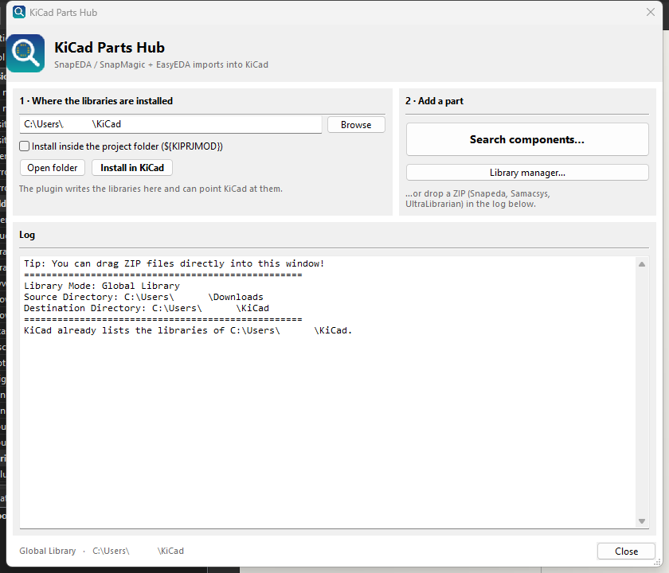
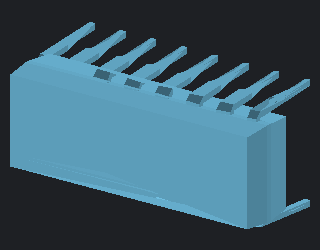
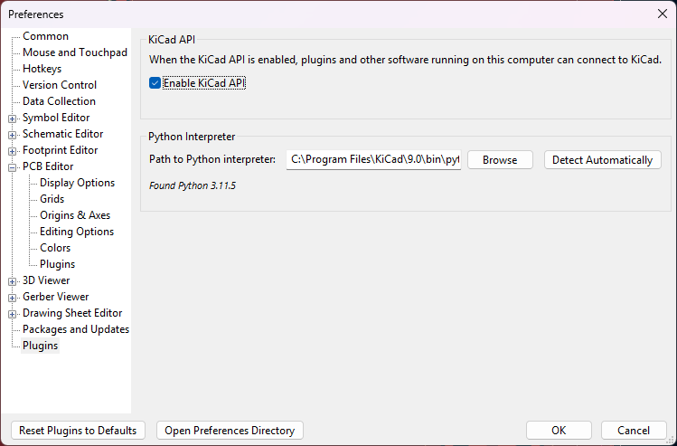

# KiCad Parts Hub 

**Unofficial community plugin.** Look a part up on [SnapEDA / SnapMagic](https://www.snapeda.com/home/), [Component Search Engine](https://componentsearchengine.com/) (Samacsys) or [EasyEDA / LCSC](https://www.lcsc.com/) without leaving KiCad, and drop it into your own libraries with its symbol, footprint, description and 3D model already linked. ZIPs downloaded somewhere else — [Octopart](https://octopart.com/), [Samacsys](https://componentsearchengine.com/), [Ultra Librarian](https://app.ultralibrarian.com/search) — are imported the same way.

**Free, open source and non-commercial.** This is a community project: it is not sold, there is no paid tier, no advertising and no telemetry, and it is shared free of charge so other people can use it. It is licensed GPL-3.0, which still lets anyone redistribute it — including commercially — under the license terms; see [License](#license) and [NOTICE.md](NOTICE.md).



<sub>The main window: header, **1 · Where the libraries are installed**, **2 · Add a part**, the log that accepts dropped ZIPs, and the footer with the current library mode.</sub>

## Table of contents

- [Features](#features)
- [Requirements](#requirements)
- [Installation](#installation)
- [Using the plugin](#using-the-plugin)
- [3D models](#3d-models)
- [Wiring the imported libraries into KiCad](#wiring-the-imported-libraries-into-kicad)
- [Standalone GUI and CLI](#standalone-gui-and-cli)
- [Troubleshooting and logs](#troubleshooting-and-logs)
- [Privacy and your accounts](#privacy-and-your-accounts)
- [Project layout](#project-layout)
- [Development setup](#development-setup)
- [Credits and thanks](#credits-and-thanks)
- [License](#license)
- [Disclaimer and acceptable use](#disclaimer-and-acceptable-use)
- [FAQ](#faq)

## Features

- **Component Search** — one window with four tabs: `SnapEDA`, `Component Search Engine` (Samacsys), `EasyEDA / LCSC` and `Library`. The first three search their site from inside KiCad and hand the ZIP to the same importer; the library name comes from the archive format (`Snapeda`, `Samacsys`, `EasyEDA`).
- **Downloads through the plugin's own browser** — a separate Chrome/Edge profile (your normal profile is untouched) with DevTools enabled, so the session survives KiCad updates and App-Bound Encryption. The downloaded ZIP lands in a watched folder and is imported automatically, with an on-screen notification when it is done.
- **Main window with two jobs** — a header, two numbered cards (**1 · Where the libraries are installed** and **2 · Add a part**), a log that also accepts dropped ZIP files, and a footer showing the library mode and folder.
- **Library manager** — every imported part with its symbol, footprint and 3D model, a quick preview of each (symbol drawing, footprint drawing, VRML triangles or STEP surfaces) and a delete button.
- **Automatic KiCad setup** — the plugin writes `KICAD_3RD_PARTY`, `sym-lib-table` and `fp-lib-table` itself (keeping a `.bak` copy), repairs broken or missing 3D model links, and can do the same for a project-local library with `${KIPRJMOD}`.
- **Drag & drop, CLI and fallback mode** — import a ZIP from the file manager, from the command line, or without the KiCad API at all.

## Requirements

- **KiCad 9.0 or newer** (tested with 10.0). KiCad 6/7/8 work with the fallback import path.
- Windows, macOS or Linux.
- No separate Python installation: the plugin runs inside KiCad's own Python. Only the standalone GUI needs Python 3 with wxPython.

## Installation

### From the Plugin and Content Manager (recommended)

1. Download `kicad-parts-hub-pcm.zip` (from the releases page of this repository or from a local build, see below).
2. In KiCad open the **Plugin and Content Manager**, choose **Install from File...** and select the ZIP.
3. Restart KiCad.

### From a local build of this repository

```bash
python build_pcm_zip.py            # -> kicad-parts-hub-pcm.zip
python build_pcm_zip.py --install  # ... and copy the payload straight into
                                   #     Documents/KiCad/<version>/3rdparty/plugins/
```

`build_pcm_zip.py` is pure Python (no bash, `jq` or `zip` needed) and writes exactly what KiCad's PCM expects: `metadata.json` at the ZIP root, the payload inside `plugins/`, plus the optional `resources/`. The ZIP never contains the saved session, the plugin browser profile, `__pycache__`, logs or submodule test folders.

The installed package folder is named after the package identifier (`com.github.<owner>.kicad-parts-hub`). Restart KiCad after installing: the plugin is loaded at start-up.

## Using the plugin

Open the import window from the **PCB Editor** or the **Schematic Editor** → **Tools** → **External Plugins** → **KiCad Parts Hub**.

### Main window

| Element | What it does |
| --- | --- |
| **1 · Where the libraries are installed** | The library folder (default `~/KiCad`), the *Install inside the project folder (`${KIPRJMOD}`)* switch, **Open folder** and **Install in KiCad**. |
| **2 · Add a part** | **Search components…** opens Component Search; **Library manager…** opens the library tab directly. |
| **Log** | Progress of every import. Also the drop target: drag a vendor ZIP onto it and the import starts. |
| **Footer** | Current mode and folder (`Global Library · C:\Users\you\KiCad`). |

An import never runs from a watched source folder any more: it starts from Component Search, from **Import ZIP...**, or from a dropped ZIP.

### Component Search

**SnapEDA / SnapMagic (hybrid flow, no direct download POST):**

1. Search the part number in the `SnapEDA` tab.
2. Select the result and press **Download in browser** — the part page opens in the plugin's browser window, already signed in when a session was imported.
3. Press **Download** on that page and choose the KiCad format.
4. The ZIP is **imported by itself**: the plugin forces its own download folder (inside the plugin browser profile) and, as a fallback, watches `~/Downloads` while a download is pending. It waits for the file size to settle, checks that it is a real ZIP with KiCad files in it, imports it and moves it to `imported/` so it is never imported twice.
5. A notification in the lower right corner reports the result.

Prefer your own browser? Use **Import ZIP...** or drop the file on the log. That path never depends on Cloudflare.

**Component Search Engine (Samacsys):**

- Search goes over HTTP with the plugin browser's cookies (`__cf_bm`) first; when Cloudflare blocks it, the same query is asked **through the browser** and the rendered result is read. Searching therefore keeps working when the site tightens its check.
- Downloading needs a free CSE account. Sign in **once** in the plugin browser window (**Session / Login** → *Open CSE browser window*). From then on the tab reads the browser cookies every 15 s, saves them to `cse_session.json` (separate from the SnapEDA session) and re-injects that session into the browser before opening a part page, so a deleted profile or a KiCad update does not ask for the password again. *Read session* still exists to force it by hand.

**EasyEDA / LCSC:** search by LCSC part number or by description and import the part directly; symbols get the real value (`10kΩ`, `100nF`, from EasyEDA's `c_para.Value`) while the part number stays in `LCSC Part` / `MPN`.

### Library manager (tab `Library`)

- One row per part, with marks for what is installed (`Symbol`, `Footprint`, `3D model`) and the exact file paths of the selected part.
- **The footprint is resolved through the `Footprint` property of the symbol**, not by file name: `2N7002P` is drawn with `SOT95P230X110-3N`. If the referenced footprint is missing from the folder, the row says so with its name (`Samacsys:XTAL_FC-135_EPS`) instead of claiming "no footprint".
- **Quick preview** on the right with three buttons:
  - `Symbol` — the real drawing from the `.kicad_sym` (body, pins, arcs).
  - `Footprint` — the real drawing from the `.kicad_mod`: pads with their shape and rotation, silkscreen and fab layer.
  - `3D` — the model. Model files are read from the footprint's own `(model ...)` references first (extension tolerant: `.step` in the footprint, `.stp` on disk), then by name. A `.wrl` (EasyEDA) is drawn as shaded triangles; a `.step`/`.stp` (SnapEDA, Samacsys, Ultra Librarian) is rebuilt from the STEP topology (`ADVANCED_FACE` → `FACE_OUTER_BOUND` → `EDGE_LOOP` → `CARTESIAN_POINT`) and shaded the same way. If the preferred file yields no geometry the next one is tried, and the summary line names the file and its face/vertex count. When nothing is found, the status line says **which file name was looked for** and in which `*.3dshapes` folders.
- **Filter**, **Refresh**, **Open folder**, **Delete selected** (removes the symbol block from the `.kicad_sym`, the `.kicad_mod` and the 3D files of that part; the rest of the library stays byte-identical) and **Install library paths in KiCad**.



<sub>The `3D` view of an imported part (here `L293D`, a SnapEDA `.step` rebuilt from its own topology).</sub>

## 3D models

- A ZIP with a symbol and a footprint links the model to that footprint.
- SnapEDA ships many parts **as a 3D model only** (the ZIP holds a loose `.step`). Such a model is stored in `<Lib>.3dshapes` of the library that already has the footprint, and the footprint is repointed to it; names are compared ignoring case and separators (`TE_2337857-1` ↔ `2337857-1.step`). If that footprint does not exist yet, the model stays in `Partial.3dshapes` and the log tells you to import the symbol and footprint first.
- Models are always written uncompressed (`.step`, never `.step.gz`, which KiCad ignores). Old `.step.gz` files are unpacked during the KiCad setup step.
- The setup also **repairs links**: a footprint pointing at a file that does not exist is repointed to the same-stem model of `<Lib>.3dshapes`, and a footprint with **no** `(model ...)` block gets one when the model is on disk — so KiCad's 3D viewer shows the part without re-importing it. A model that merely shares the *symbol* name is never attached, which is what used to make one vendor's part show another vendor's 3D file.

## Wiring the imported libraries into KiCad

✅ **Automatic:** the plugin writes these settings itself (a `.bak` copy is kept next to each file), both after every import and at start-up when libraries are already there. The manual steps below are only the fallback for a KiCad setup the plugin cannot write.

You can also run it on demand: **Component Search** → tab `Library` → **Install library paths in KiCad**, or **Install in KiCad** in the main window. With *Install inside the project folder (`${KIPRJMOD}`)* enabled it writes the project's own `sym-lib-table` / `fp-lib-table` instead.

**Step 1: Configure the environment variable**

**Preferences** → **Configure paths** → **Environment Variables** → add:

| Name            | Path                        |
| --------------- | --------------------------- |
| KICAD_3RD_PARTY | **YourLibraryFolder**/KiCad |

**Watch the variable name.** KiCad's own Plugin and Content Manager already defines entries such as `KICAD9_3RD_PARTY` and `KICAD10_3RD_PARTY`; leave those alone. The name this plugin looks for is a separate, additional entry called `KICAD_3RD_PARTY`.

**Step 2: Import a first part**

KiCad refuses a table entry whose file does not exist yet, so import one part per source before touching the tables, and add only the libraries you really use in steps 3 and 4.

**Step 3: Add the symbol libraries**

**Preferences** → **Manage Symbol Libraries** → **Global Libraries** → add:

| Active             | Visible            | Nickname       | Library Path                                | Library Format |
| ------------------ | ------------------ | -------------- | ------------------------------------------- | -------------- |
| :heavy_check_mark: | :heavy_check_mark: | Samacsys       | ${KICAD_3RD_PARTY}/Samacsys.kicad_sym       | KiCad          |
| :heavy_check_mark: | :heavy_check_mark: | Snapeda        | ${KICAD_3RD_PARTY}/Snapeda.kicad_sym        | KiCad          |
| :heavy_check_mark: | :heavy_check_mark: | UltraLibrarian | ${KICAD_3RD_PARTY}/UltraLibrarian.kicad_sym | KiCad          |
| :heavy_check_mark: | :heavy_check_mark: | EasyEDA        | ${KICAD_3RD_PARTY}/EasyEDA.kicad_sym        | KiCad          |

**Step 4: Add the footprint libraries**

**Preferences** → **Manage Footprint Libraries** → **Global Libraries** → add:

| Active             | Nickname       | Library Path                             | Library Format |
| ------------------ | -------------- | ---------------------------------------- | -------------- |
| :heavy_check_mark: | Samacsys       | ${KICAD_3RD_PARTY}/Samacsys.pretty       | KiCad          |
| :heavy_check_mark: | Snapeda        | ${KICAD_3RD_PARTY}/Snapeda.pretty        | KiCad          |
| :heavy_check_mark: | UltraLibrarian | ${KICAD_3RD_PARTY}/UltraLibrarian.pretty | KiCad          |
| :heavy_check_mark: | EasyEDA        | ${KICAD_3RD_PARTY}/EasyEDA.pretty        | KiCad          |

**Step 5: Restart KiCad** so it reads the new tables.

### KiCad IPC API (recommended) and fallback

This is the mode to use on current KiCad: the plugin gets an environment of its own with the dependencies it needs, starts quicker and never asks you to wire a library by hand.

1. **KiCad** → **Settings** → **Plugins** → **Enable Plugin System**
2. Check **Enable KiCad API**
3. Restart KiCad



The plugin then appears as **KiCad Parts Hub (IPC API)** in **Tools** → **External Plugins**, in both the PCB editor and the schematic editor.

Without the API the plugin falls back to the classic `pcbnew` import path. That path needs its dependencies available to KiCad's Python; the IPC path installs them itself.

## Standalone GUI and CLI

### Standalone GUI

The same window can be started by hand, outside KiCad, on Python 3 with wxPython installed (`pip install wxPython`):

```bash
python plugins/impart_action.py
```

Started this way there is no open project to detect. Switch on *Install inside the project folder* and name that folder yourself: either in the library path field or in the dialog shown while importing.

### CLI

The importer runs headless too — useful for scripts and CI. From the `plugins` folder:

```bash
cd plugins
python -m KiCadImport -h    # the full help, including every default
```

| Option | What it does |
| --- | --- |
| `--download-folder DIR` | Import every ZIP found in that folder. |
| `--download-file ZIP` | Import one specific ZIP. |
| `--easyeda PART` | Import an EasyEDA/LCSC part by its number, for example `C2040`. |
| `--lib-folder DIR` | Where the KiCad files are written. Always required. |
| `--overwrite-if-exists` | Replace files that are already in the library. |
| `--path-variable NAME` | Variable written into the library tables. Defaults to `${KICAD_3RD_PARTY}`; use `${KIPRJMOD}` for a project-local library. |
| `--prefer-step` | EasyEDA: link the STEP model instead of the WRL one. |
| `--lib-name NAME` | Put every import into one library named `NAME`, instead of one library per source. |
| `--compress-models` | Write the STEP models gzipped (`.step.gz`). |

The first three options exclude each other: give exactly one source per run.

## Troubleshooting and logs

The plugin writes `plugin.log` (and `plugin_fallback.log` in fallback mode) next to its own files. They contain the import decisions and every error with a traceback — attach them to an issue.

**Where they are:** KiCad → **Plugin and Content Manager** → **Open Package Directory** → `plugins` → `com.github.<owner>.kicad-parts-hub`.

| Symptom | What to do |
| --- | --- |
| "No session" / Cloudflare page instead of results | **Session / Login** → *Open ... browser window*, sign in, then *Read session from that browser*. |
| Search works, download does not | Downloading needs a free account on the site. Sign in in the plugin browser once. |
| The ZIP was downloaded but nothing happened | Use a ZIP that contains KiCad files (the importer says so in the log); the watched `~/Downloads` fallback only runs while a download is pending. |
| Part imported, libraries missing in KiCad | `Library` tab → **Install library paths in KiCad**, then restart KiCad. |
| A part shows no 3D model | The row says which file name was looked for. If the vendor ZIP had no model, download the 3D model separately; the plugin links it to the existing footprint. |
| 3D preview is empty | Check `plugin.log`: every 3D view logs the file and face count it used. |

## Privacy and your accounts

The plugin has no backend of its own: there is no telemetry, no analytics, no crash reporting and no account with the authors. Every request goes from your machine to the vendor site, with your own session.

- **Cookies are read from your own browser, for the vendor domains only.** Firefox's `cookies.sqlite` is read directly; Chrome/Edge/Brave cookie stores are decrypted with your own Windows user key (DPAPI) when the `cryptography` package is available. Nothing is read for any other site.
- **Sessions are plain files on your disk.** `snapeda_session.json`, `cse_session.json` and the plugin browser profile hold login cookies in clear text. Treat them as passwords: do not commit them, do not attach them to an issue, and delete them to sign out. They are excluded from the package and from version control.
- **The plugin's browser exposes a local debugging port.** Its own Chrome/Edge window runs with `--remote-debugging-port=9222` bound to `127.0.0.1`, so the plugin can read the session and drive the page. That port has no password: any program on your machine could use it while the window is open. Close the plugin browser when you are done and do not forward the port to a network.
- **What leaves your machine:** your search terms, the ordinary browser headers and the requests needed to open a part page or download the ZIP, sent to the site you are using and nowhere else. Imported symbols, footprints and 3D models are written only to your library folder.
- **What the authors receive:** nothing. There is no server to receive it, and the plugin never sends your cookies, library or logs to the project.

## Project layout

| Part | File | What it does |
| --- | --- | --- |
| Entry point | `plugins/impart_action.py` | wx action, main window, import orchestration, IPC server |
| Main window layout | `plugins/main_window.py` | Header, cards, log and footer of the main window |
| Search UI | `plugins/snapeda_search.py` | Combined search window with the SnapEDA / CSE / EasyEDA / Library tabs |
| SnapEDA client | `plugins/snapeda_client.py` | JSON search, autocomplete, Cloudflare detection |
| SnapEDA session | `plugins/snapeda_auth.py` | Reads cookies from Firefox/Chrome/Edge or accepts a pasted `Cookie:` header |
| SnapEDA download | `plugins/snapeda_download.py` | Fetches the KiCad ZIP and hands it to the importer |
| CSE client / session / UI | `plugins/cse_client.py`, `plugins/cse_auth.py`, `plugins/cse_search.py` | Component Search Engine search, session and tab |
| Library inventory | `plugins/library_scan.py` | Symbol/footprint/3D inventory, deletion, model resolution (no wx) |
| Library preview | `plugins/library_preview.py` | S-expression parsing, symbol/footprint drawings, VRML and STEP geometry (no wx) |
| Library UI | `plugins/library_manager.py` | `Library` tab: list, previews, delete, install paths |
| KiCad setup | `plugins/kicad_setup.py` | `KICAD_3RD_PARTY`, library tables, `.bak` copies, 3D link repair |
| Importers | `plugins/KiCadImport/`, `plugins/impart_easyeda.py` | ZIP import, library writing, EasyEDA/LCSC conversion |
| Bundled parsers | `plugins/kiutils/`, `plugins/easyeda2kicad/` | Third-party libraries, see [Credits](#credits-and-thanks) |

### Endpoints used by the search tabs

Checked against the live sites on 2026-10-16:

```text
GET  /search/?q=<q>&page=<n>            search page; hands out the csrftoken cookie
POST /api/v1/search_local_internal      JSON results (20 per page, hits = total)
     body: q, page, search-type=parts, csrfmiddlewaretoken
GET  /api/v1/search_autocomplete?q=<q>  part number suggestions

Component Search Engine:
GET  /search?term=<q>[&page=<n>]        25 results per page, HTML with <tr id='row-N'>
GET  /part-view/<MPN>/<manufacturer>    part page (the Download button)
     deciding cookie: __cf_bm (Cloudflare); downloading needs a free account
```

## Development setup

Nothing has to be installed to use the plugin: KiCad runs it with its own Python, and the source is the `plugins/` folder of this repository.

To rebuild the ready-to-install package from a checkout:

```bash
python build_pcm_zip.py                    # -> kicad-parts-hub-pcm.zip
python build_pcm_zip.py --install          # ... or copy it into KiCad's 3rdparty/plugins
```

## Credits and thanks

This project would not exist without the people who built and published the work it is based on. **Thank you.**

- **[Steffen-W / Import-LIB-KiCad-Plugin](https://github.com/Steffen-W/Import-LIB-KiCad-Plugin) owns the foundation of this repository.** The importer, the GUI skeleton, the KiCad setup handling and the packaging all started there (the project is also known as *impartGUI*). Everything this fork adds — the search tabs, the library manager, the previews, the automatic setup, the packaging rework — sits on top of that work. The author of that project is not responsible for this version.
- **[wexi / impart](https://github.com/wexi/impart)** and **[topherbuckley / kicad_remote_import](https://github.com/topherbuckley/kicad_remote_import)** wrote the GUI code that the foundation above grew out of.
- **[uPesy / easyeda2kicad.py](https://github.com/uPesy/easyeda2kicad.py)** converts EasyEDA/LCSC parts, coloured 3D models included; it is bundled here under **AGPL-3.0**.
- **[mvnmgrx / kiutils](https://github.com/mvnmgrx/kiutils)** reads and writes the KiCad files and library tables; it is bundled here under **GPL-3.0**.
- **KiCad** and its developers — the EDA suite this plugin runs in, and the format documentation that made the parsers possible.
- **SnapEDA/SnapMagic, Component Search Engine (Samacsys), EasyEDA/LCSC, Octopart and Ultra Librarian** — the part libraries and their public pages. Their names and logos are trademarks of their owners; this plugin only automates what you can already do by hand with your own account in a browser.

## License

This project is licensed under the **GNU General Public License v3.0** — see [LICENSE.txt](LICENSE.txt). It is a derivative work of *Import-LIB-KiCad-Plugin* by Steffen-W, which is published under the same license, so the GPL-3.0 terms (including the copyleft and the "no additional restrictions" rules) apply to this repository and to any redistribution.

[**NOTICE.md**](NOTICE.md) is the modification and attribution notice required by GPL-3.0 section 5(a): it names the original author, lists what was changed and when, and records the bundled licenses. The derived source files also carry a short notice at the top.

Bundled third-party components keep their own licenses: `plugins/kiutils` is GPL-3.0, and `plugins/easyeda2kicad` is **AGPL-3.0**, whose network-use clause applies to that component. Both license texts are vendored next to the code (`plugins/kiutils/LICENSE`, `plugins/easyeda2kicad/LICENSE`) and are shipped inside every package, together with `LICENSE.txt` and `NOTICE.md`. If you redistribute or host a modified version, read both license texts first and keep all copyright notices intact.

No commercial use is intended by the authors: the project is published free of charge. That statement does not restrict anyone's GPL-3.0 rights — the license still allows redistribution, including for a fee, as long as its terms are met.

The source of this package lives at <https://github.com/CapedSaur/kicad-parts-hub>.

## Disclaimer and acceptable use

**No warranty.** This software is provided "as is", without warranty of any kind, express or implied, including but not limited to the warranties of merchantability, fitness for a particular purpose and non-infringement. **Use it at your own risk.** The plugin modifies files in your KiCad configuration and library folders (`kicad_common.json`, `sym-lib-table`, `fp-lib-table`, symbol, footprint and 3D files), and it repairs footprints in place. Keep your work under version control or a backup, and review the diff before relying on it.

**Not affiliated.** This is an independent, unofficial community project. It is not affiliated with, authorised, sponsored or endorsed by KiCad, SnapEDA/SnapMagic, Component Search Engine (Samacsys), EasyEDA, LCSC, Octopart or Ultra Librarian. All product names, logos and trademarks belong to their respective owners and are used only to describe interoperability.

**Acceptable use.** The search and download features automate the same requests a normal browser session makes with **your own** account and cookies; nothing bypasses a paywall, a license or an access control. You are responsible for using each vendor's service under its own terms of service, for respecting its rate limits, robots policy and content licenses, and for keeping your session cookies — `snapeda_session.json`, `cse_session.json` and the plugin browser profile are secrets, they stay out of the package and out of version control, and you should not share or publish them. Do not use this plugin to scrape, mirror or redistribute other people's library data at scale, or for any purpose that is unlawful in your jurisdiction.

**Vendor terms, one by one.** Automated access is not automatically allowed, and the rules differ per site — check them yourself and stop using a tab if your use does not fit:

- **SnapEDA / SnapMagic** — searching uses their public pages and JSON endpoints; downloading needs your own free account and happens in the plugin browser, on their page, with their own Download button. Their terms govern whether and how you may use the downloaded files.
- **Component Search Engine (Samacsys)** — needs a free account to download; the plugin reuses your logged-in session. Respect their rate limits and do not share the account.
- **EasyEDA / LCSC** — read through the public endpoints used by their web page, then converted locally with the bundled `easyeda2kicad` (AGPL-3.0).
- **Octopart, Ultra Librarian and other ZIP sources** — the plugin only imports a file you downloaded yourself, with your own account.

**Imported data is not yours to republish.** Symbols, footprints and 3D models stay under the vendor's own terms even after they land in your library folder. Use them in your own designs; do not publish a vendor's library as your own package or mirror.

**No server, no data collection.** The project runs entirely on your machine; see [Privacy and your accounts](#privacy-and-your-accounts).

**Any misuse is the sole responsibility of the user.** The authors and contributors of this project accept **no liability** for any damage, data loss, broken design, lost production, legal consequence or other harm caused by the use, misuse, modification or redistribution of this software. Symbols, footprints and 3D models come from third parties and may be wrong, incomplete or out of date: **verify every part yourself** — pinout, dimensions, pad sizes, clearances and 3D alignment — before you order boards or manufacture anything. Nothing produced by this tool is a substitute for your own engineering review.

## FAQ

**Do I have to create the library files before importing?**

No. The plugin creates them: one library per source (`Samacsys.kicad_sym`, `Snapeda.kicad_sym`, `EasyEDA.kicad_sym`, …), with the matching `.pretty` and `.3dshapes` folders.

**Can I merge everything into one library?**

Yes. Enable the single-library option (`--lib-name` on the CLI) and give a name; all imports go into that one library instead.

**Where can the libraries live?**

Anywhere you have read and write access, including network or cloud drives. The library tables use the `KICAD_3RD_PARTY` (or `${KIPRJMOD}`) variable, never a hard-coded absolute path, so moving the folder only means changing the variable.

**Can I move the library folder later?**

Yes, but existing files are not moved automatically — move the folder yourself and point the variable at the new place.

**Can I import from several sources at the same time?**

Yes. Each source keeps its own library, and you can mix them freely in a project.

**Can I remove a library from KiCad's tables?**

Yes. Removing a table entry neither deletes nor edits the files.

**Why does the 3D preview of a vendor STEP file look like a rough surface?**

Reconstructing a full B-rep surface needs a CAD kernel. The preview rebuilds the faces from the STEP topology, which is enough to recognise the part but is not a renderer. KiCad's own 3D viewer shows the file as the vendor exported it.
